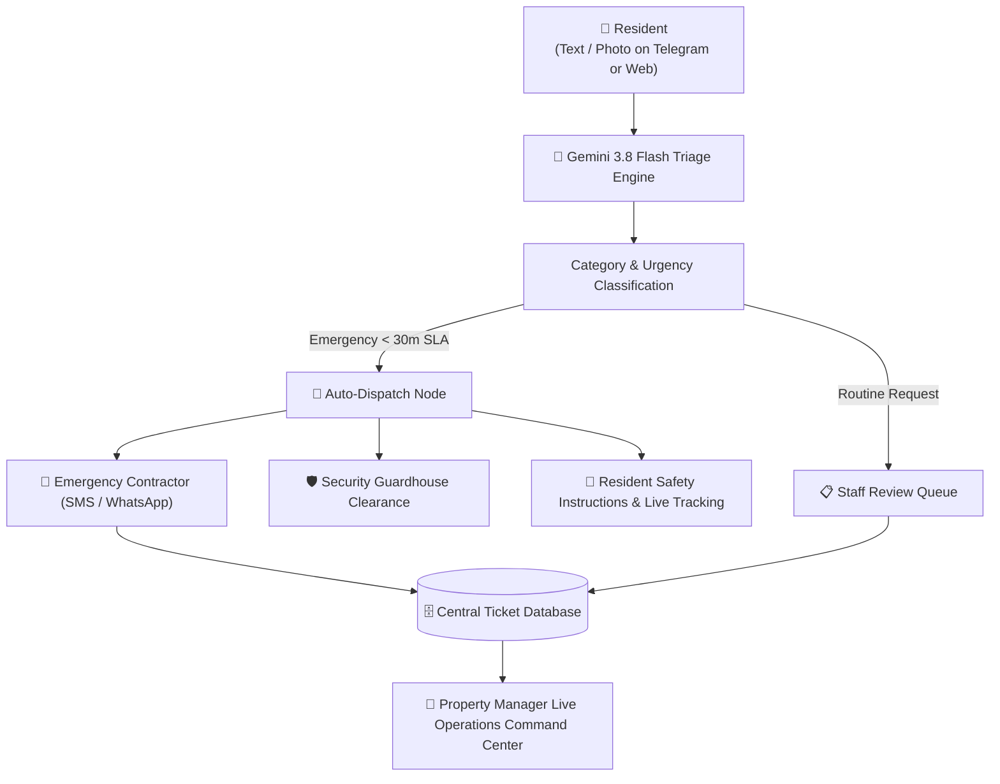

# 00. Executive Summary & Vision

## 1. Product Vision
The **Condo Management & Emergency Dispatch Agent** transforms traditional, slow-moving condominium customer service into an **autonomous, 24/7 proactive emergency coordination network**. 

Residents encounter critical, time-sensitive faults (e.g. burst pipes, electrical fires, elevator entrapments, or security breaches) at all hours. By pairing **instant Telegram messaging** with **multimodal AI triage (Google Gemini 3.8 Flash)**, the system immediately recognizes the hazard, provides interim safety instructions to the resident, and **automatically dispatches the appropriate on-call contractor** within seconds.

---

## 2. Problem Statement vs. Solution

| Traditional Property Management | Autonomous AI Management Agent |
| :--- | :--- |
| **Delayed Response:** Emergency emails or form submissions sit in unmonitored inboxes overnight or on weekends. | **Instant Multi-Modal Triage:** Responses and classification take < 2 seconds 24/7/365. |
| **Manual Contractor Calls:** Property officers must manually find vendor contacts, explain the fault, and call for dispatch. | **Autonomous Dispatch:** Agent generates a formal Work Order, sends an SMS/alert directly to the on-call vendor, and alerts security guards. |
| **Panic & Lack of Guidance:** Residents watch water flood their units without knowing where the main shutoff valve is. | **Actionable Interim Safety:** The bot immediately provides customized safety instructions (e.g., turn off water valve, do not use lifts). |
| **Fragmented Communication:** Multiple calls between residents, management, and vendors lead to lost context. | **Single Source of Truth:** Centralized database tracks the complete lifecycle from `Submitted` to `Resolved` with full audit logs. |

---

## 3. High-Level Flowchart

---

## 4. Key Differentiators
1. **Zero-App-Download Friction:** Residents use Telegram, an app already installed on their devices.
2. **Visual Hazard Perception:** Residents snap a photo of the leak or damage; Gemini 3.8 Flash inspects the photo directly.
3. **Closed-Loop Action:** It doesn't just categorize text; it executes work orders, notifies vendors, and alerts security.
4. **Auditability & Governance:** Property managers maintain full oversight via a centralized dashboard with manual override capabilities.
