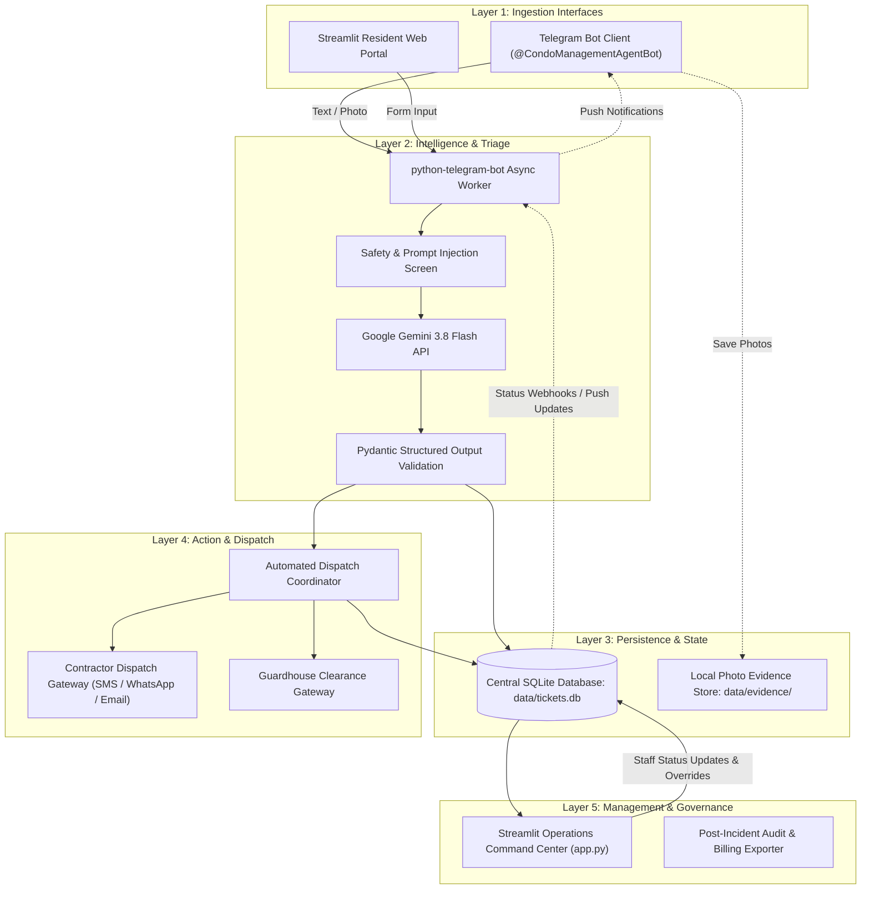

# 01. System Architecture

## Architecture Overview

The system is built on a modular, decoupled architecture consisting of five primary layers:
1. **Resident Interaction Layer** (Telegram Bot + Web Help Desk)
2. **AI Perception & Triage Engine** (Google Gemini 3.8 Flash + LangGraph State Engine)
3. **Dispatch & Notification Gateway** (Simulated & Live Contractor Outbound Dispatch)
4. **Data Persistence & Audit Layer** (SQLite / PostgreSQL State Store)
5. **Staff Operations Command Center** (Streamlit Real-Time Dashboard)

---

## Component Diagram

---

## Detailed Component Specifications

### 1. Ingestion Layer
* **Telegram Interface (`telegram_bot.py`):**
  * Asynchronous polling via `python-telegram-bot` (v22.x).
  * Handles text messages, photo attachments with captions, and inline callback button clicks.
* **Streamlit Web Portal (`app.py`):**
  * Browser-based fallback for residents and front-desk reception staff.

### 2. Triage & Decision Layer
* **Model:** `gemini-3.8-flash` via official `google-genai` SDK.
* **Multimodal Capability:** Accepts base64/binary image payloads alongside text.
* **Strict Schema Enforcement:** Returns validated `TriageDecision` Pydantic models with zero hallucinated keys.
* **Safety & Prompt Injection Guard:** Pre-screening against adversarial prompts and sensitive financial/PII claims.

### 3. State & Persistence Layer
* **Database:** `data/tickets.db` (SQLite for local/PoC, PostgreSQL compatible for production).
* **Storage Structure:**
  * `tickets`: Main entity record (Ticket ID, resident info, category, priority, status).
  * `dispatches`: Log of all outbound contractor alerts, timestamps, and recipient phone numbers.
  * `evidence`: Photo files referenced by hash and ticket ID.

### 4. Dispatch Gateway
* **Routing Logic:** Maps `category` + `priority` to pre-registered vendors.
* **Notification Formats:**
  * SMS payload generator (< 160 chars for GSM compatibility).
  * Formatted Work Order Markdown for email/webhook transmissions.
  * Guardhouse visitor security clearance generation.

### 5. Staff Operations Dashboard
* Real-time refresh of tickets.
* Interactive status controls: `Acknowledge`, `Mark In Progress`, `Reassign Vendor`, `Mark Resolved`.
* Incident analytics: Mean Time to Dispatch (MTTD), Mean Time to Resolution (MTTR), fault distribution charts.
