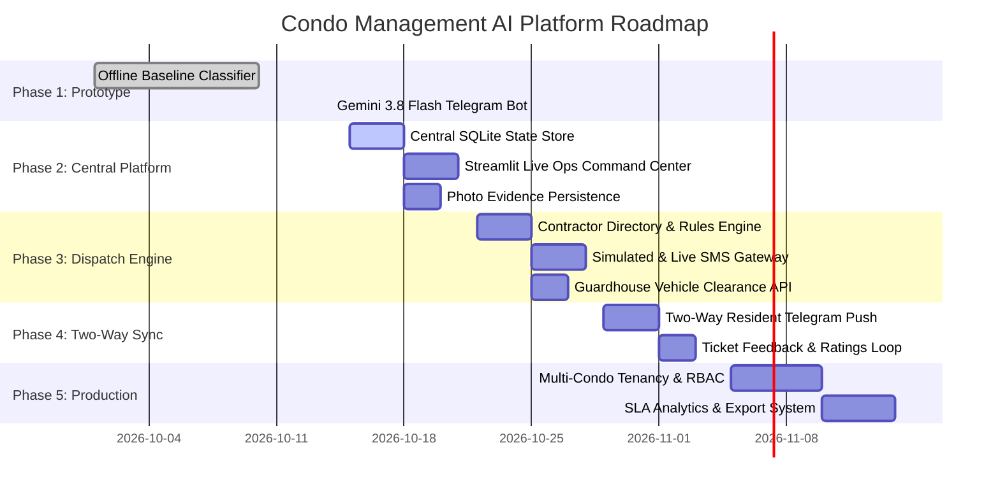

# 02. Phased Roadmap & Milestones

This document details the multi-phase implementation roadmap to evolve the project from its current operational prototype to an enterprise-grade condominium management system.

---

## Roadmap Overview & Gantt View

---

## Detailed Milestones

### Phase 1: Ingestion & Core Perception (Status: COMPLETED ✅)
- [x] Clone and evaluate the initial offline baseline classifier.
- [x] Set up isolated Python 3.12 environment using `uv`.
- [x] Verify complete test suite passing (64 unit and integration tests).
- [x] Register official Telegram Bot (`@CondoManagementAgentBot`) via BotFather.
- [x] Implement `telegram_bot.py` powered by Google Gemini 3.8 Flash.
- [x] Implement multimodal image inspection (photo attachment triage).
- [x] Test live emergency reporting, classification, and inline safety button responses.

---

### Phase 2: Unified Central Database & Management Dashboard (Status: COMPLETED ✅)
*Goal: Bridge the Telegram bot with the web interface so property managers can see and act on tickets in real-time.*

- [x] **Task 2.1: SQLite Central Database (`data/tickets.db`)**
  - Implemented `condo_classifier/database.py` with native sqlite3.
  - Created tables for `tickets`, `dispatches`, and `timeline_events`.
- [x] **Task 2.2: Dual-Ingestion Persistence**
  - Modified `telegram_bot.py` to write every ticket and dispatch directly into `tickets.db`.
  - Saved photo attachments to `data/evidence/<ticket_id>.jpg`.
- [x] **Task 2.3: Streamlit Live Operations Tab (`app.py`)**
  - Added dedicated **"Live Operations & Dispatch"** tab.
  - Implemented real-time ticket queue with status/priority/category filters.
  - Added staff action buttons: `Mark In Progress`, `Mark Resolved` with staff notes.
- [x] **Task 2.4: Regression Testing**
  - Ensured all original tests in `tests/` pass without regression.

---

### Phase 3: Advanced Dispatch Engine & Notification Gateway (Status: COMPLETED ✅)
*Goal: Provide robust multi-channel contractor dispatch and on-site guardhouse clearance.*

- [x] **Task 3.1: Configurable Vendor Directory (`data/vendors.json`)**
  - Supported custom vendors per category and domain (plumbing, electrical, lifts, security, cleanliness, facilities, noise, parking, billing).
  - Included on-call schedules, emergency phone numbers, and SLA targets.
- [x] **Task 3.2: Multi-Channel Outbound Dispatch Engine (`condo_classifier/dispatch.py`)**
  - Implemented simulated and live contractor SMS dispatch formatting.
  - Implemented guardhouse clearance generator with unique visitor vehicle access passcodes (`PASS-...`).
- [x] **Task 3.3: Automated SLA Countdown**
  - Implemented live countdown timers, breach alerts, and progress bars in `app.py`.

---

### Phase 4: Two-Way Telegram Sync & Resident Experience (Status: COMPLETED ✅)
*Goal: Close the loop by proactively messaging residents when their ticket status changes.*

- [x] **Task 4.1: Proactive Status Push (`condo_classifier/notifications.py`)**
  - Automatic push notification sent to resident's Telegram chat upon staff status updates (`IN_PROGRESS`, `RESOLVED`).
- [x] **Task 4.2: Resident Status Commands**
  - Implemented `/status <WO_ID>` and `/mytickets` commands in `@CondoManagementAgentBot`.
- [x] **Task 4.3: Resident Quality & Feedback Score**
  - Interactive 1–5 star rating keyboard pushed to Telegram on ticket resolution; captured in `tickets.db` and audit timeline.

---

### Phase 5: Production Hardening, Multi-Tenancy & Analytics (Status: IN PROGRESS ⏳)
*Goal: Scale the system for commercial deployment across multiple residential estates.*

- [ ] **Task 5.1: Multi-Tenancy Architecture**
  - Segregate data by condominium property (e.g. Oceanfront Residences vs. Marina Bay Towers).
- [ ] **Task 5.2: Role-Based Access Control (RBAC)**
  - Guardhouse view (visitor clearance & contractor gate access).
  - Technician mobile web portal (accept/decline work orders).
  - Managing Agent Executive view (SLA compliance & expenditure).
- [x] **Task 5.3: Automated Post-Incident Audit Reports**
  - One-click Markdown/Text audit report export (`generate_audit_report`) downloadable directly from Streamlit Live Operations Hub.
