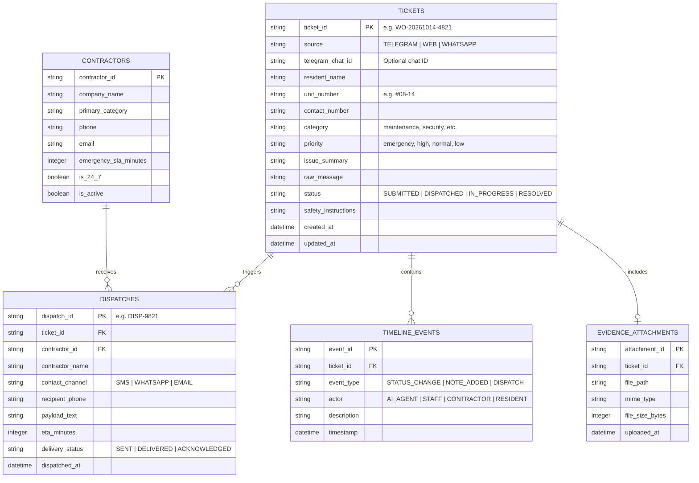

# 03. Data Models & Schemas

This document defines the core data contracts, Pydantic schemas, and database entity relationships used across the platform.

---

## 1. Entity-Relationship Diagram (ERD)



---

## 2. Pydantic Models (`condo_classifier/schema.py`)

### Gemini Structured Output Model
```python
from pydantic import BaseModel, Field


class TriageDecision(BaseModel):
    category: str = Field(
        description="One of: maintenance, security, noise, cleanliness, facilities, parking, billing, general_enquiry, other"
    )
    priority: str = Field(description="One of: emergency, high, normal, low")
    issue_summary: str = Field(description="Clear 1-sentence summary of the incident")
    unit_number: str | None = Field(
        default=None, description="Resident unit number if mentioned (e.g. #08-14)"
    )
    is_emergency: bool = Field(
        description="True if pipe burst, major leak, lift entrapment, electrical fire, or intruder"
    )
    assigned_entity: str = Field(description="Name of the contractor or internal team assigned")
    entity_contact: str = Field(description="Phone or contact number of the assigned entity")
    eta_minutes: int = Field(
        description="Estimated arrival time in minutes (15-30 for emergencies, 120+ for normal)"
    )
    safety_instruction: str | None = Field(
        default=None,
        description="Urgent interim advice (e.g. turn off water valve, do not use lift)",
    )
```

---

## 3. SQLite DDL Schema (`data/tickets.db`)

```sql
CREATE TABLE IF NOT EXISTS tickets (
    ticket_id TEXT PRIMARY KEY,
    source TEXT NOT NULL,
    telegram_chat_id INTEGER,
    resident_name TEXT,
    unit_number TEXT,
    contact_number TEXT,
    category TEXT NOT NULL,
    priority TEXT NOT NULL,
    issue_summary TEXT NOT NULL,
    raw_message TEXT NOT NULL,
    status TEXT NOT NULL DEFAULT 'SUBMITTED',
    assigned_entity TEXT,
    entity_contact TEXT,
    eta_minutes INTEGER,
    safety_instruction TEXT,
    created_at TIMESTAMP DEFAULT CURRENT_TIMESTAMP,
    updated_at TIMESTAMP DEFAULT CURRENT_TIMESTAMP
);

CREATE TABLE IF NOT EXISTS dispatches (
    dispatch_id TEXT PRIMARY KEY,
    ticket_id TEXT NOT NULL,
    contractor_name TEXT NOT NULL,
    contact_channel TEXT NOT NULL,
    recipient_phone TEXT NOT NULL,
    message_text TEXT NOT NULL,
    delivery_status TEXT NOT NULL,
    created_at TIMESTAMP DEFAULT CURRENT_TIMESTAMP,
    FOREIGN KEY (ticket_id) REFERENCES tickets(ticket_id)
);

CREATE TABLE IF NOT EXISTS timeline_events (
    event_id INTEGER PRIMARY KEY AUTOINCREMENT,
    ticket_id TEXT NOT NULL,
    actor TEXT NOT NULL,
    event_type TEXT NOT NULL,
    description TEXT NOT NULL,
    created_at TIMESTAMP DEFAULT CURRENT_TIMESTAMP,
    FOREIGN KEY (ticket_id) REFERENCES tickets(ticket_id)
);
```
