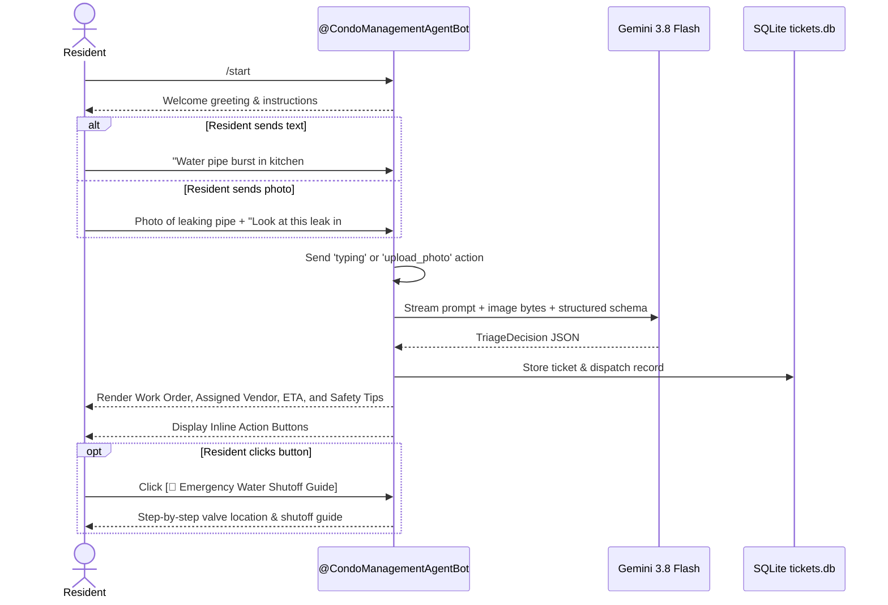

# 05. Telegram Bot Specification

## Bot Identity
* **Handle:** `@CondoManagementAgentBot`
* **Direct URL:** `https://t.me/CondoManagementAgentBot`
* **Display Name:** `MANAGEMENT AGENT` (Oceanfront Residences)
* **Framework:** `python-telegram-bot` (v22.x, async polling mode)
* **AI Model:** `gemini-3.8-flash` via `google-genai` SDK

---

## 1. Resident Interaction Flow



---

## 2. Command Reference

| Command | Scope | Description |
| :--- | :--- | :--- |
| `/start` | Public | Initiates conversation with the resident and presents feature overview. |
| `/help` | Public | Explains supported request types and emergency hotlines. |
| `/status <id>` | Planned (Phase 4) | Checks live status and ETA of a specific Work Order (e.g. `/status WO-20261014-4821`). |
| `/mytickets` | Planned (Phase 4) | Lists all active and recent tickets submitted by the resident's Telegram account. |

---

## 3. Multimodal Photo Handling
* Residents frequently upload photos of leaks, broken door locks, dirty common areas, or illegal parking.
* The bot automatically captures the highest-resolution photo from the `photo` array:
  ```python
  photo_file = await message.photo[-1].get_file()
  photo_stream = io.BytesIO()
  await photo_file.download_to_memory(photo_stream)
  photo_bytes = photo_stream.getvalue()
  ```
* Passes `photo_bytes` as a `types.Part.from_bytes(data=photo_bytes, mime_type="image/jpeg")` object directly to `gemini-3.8-flash`.

---

## 4. Interactive Inline Button Architecture

When an emergency or service ticket is returned, the bot attaches an `InlineKeyboardMarkup`:

```text
+------------------------------------+------------------------------------+
|  🚰 Emergency Water Shutoff Guide  |       📞 Call Assigned Tech        |
+------------------------------------+------------------------------------+
|                      📋 View Live Work Order                            |
+-------------------------------------------------------------------------+
```

* **`guide_water` Callback:** Displays immediate step-by-step shutoff guidance.
* **`call_<phone>` Callback:** Formats and displays the direct phone number for the assigned technician.
* **`view_<wo_id>` Callback:** Fetches live clearance and transit status for the ticket.
